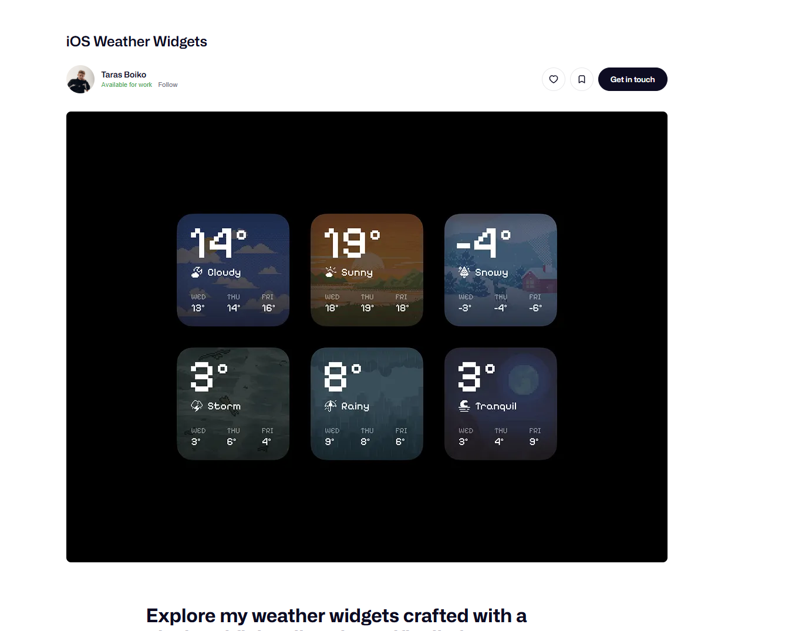

Zu entwickeln ist eine Android Smartphone-Anwendung die modern und wie ein retro videospiel designed ist. Der Name der Anwendung ist Momentum und wird dazu genutzt sein eigenes seelisches Momentum zu messen. Das Momentum ist hierbei eine Zahl die sich bei bestimmten Events und bestimmten Regeln folgend verändert. H

Der Hauptscreen hat als primäres Element die Momentum anzahl ist einer Retro gamy Schriftart. Darunter zentral im Screen läuft die Animation des aktuellen Fahrzeugs. Hierbei stellen die Fahrzeuge konfigurierbare Meilensteine des Momentumwerts dar.

Ein weiterer Screen zeigt die Accelerators. Ein Accelerator ist eine Regel, die den Momentumwert erhöht, wenn man den Wert davon anklickt. Ein beispiel ist das erledigen einer Aufgabe, die den Momentumwert um 5 erhöht. Das ist ein Accelarator mit konstantem Wachstum. Man kann auch eine konvergenz gegen 0 auswählen. Bei jedem klick sinkt dann das wachstum gemäss der spezifizierten regel. Bei der konvergenz gegen 0 wird der wert schnell weniger und dann immer langsamer. Bei linearem decay wird es dann linear weniger und geht nicht unter 0. Es gibt also die einstellungen exponential, linear und constant. Hierbei kann man bei allen die entsprechenden parameter festlegen. In dieesem screen kann man auch neue Accelerators erstellen. Standardeinstellung istt constant. natürlich kann es sein, dass man über mehrere tage keinen accelarator anklickt. Das soll dann dazu führen, dass sich der aktuelle inkrementwert wieder auch die basiseinstellung zurücksetzt. Ist beispielsweise 10 gesetzt und der decay exponentiell und tage auf 10 gestellt, dann soll nach 10 tagen auf 10 zurückgestellt werden. Man soll bei linear und exponential auch einen minwert einstellen.

Ein weiterer screen zeigt die Decelerators. Diese sind ähnlich, aber verringern den Momentumwert bei klicks gemäß bestimmer regeln. Diese einstellung soll analog zu den accelerators funktionieren.

Diese beiden screens sollen thematisch gegensätze zeigen. Alles pixelart retromäßig.

Ein weiterer screen zeigt die einstellungen. Hier kann zeitzone und profilbuild gesetzt werden und logout und so weiter. Also alle sachen die nach deinem ermessen einstellbar sein sollen.

Jeder accelerator und decelarator soll ein pixelart icon bekoommen können. Mache hierfür weitere 20 pixelarts, die relevant sein könnten.

Der momentumwert soll jeden tag decayen nach bestimmten regeln. Auf dem decelerator screen soll man diesen decelerator ganz oben sehen können mit einem kalender pixelart. Hier soll man das daily decay einstellen können. Dieses soll einen basiswert haben und einen decay catalyst term, der auch linear und exponentiell und umgekehrt exponentiell sein kann. Dieser soll greifen, wenn man an einem tag keine bestimmte schwelle an momentum addiert hat. Je läanger die streak ist in der man diesen wert nicht trifft, schreitet der catalyst weiter fort in seinem parameter und wird größer.

Das einstellen von accelerators und decelerators soll auf eine interessante art udn werise funktionieren. Hier steht ein fliesstext mit lücken der die funktionsweise erklärt und gleichzeitig kann man in den löcken sachen umstellen. Bei unterschiedlichen einstellungen soll sich der löckentext komplett auch ändern können. Die schriftart in der ganzen app soll so gamy minecrafthaftig aussehen.

Klickt man in der liste auf einen accellerator dann soll natürlich die funktion davon getriggert werden. GLeich bei den decelerators und so.

Alle 10000 momentum soll ein meilenstein erreicht werden. Wird ein meilenstein erreicht,

Hier eine stilreferenz 
